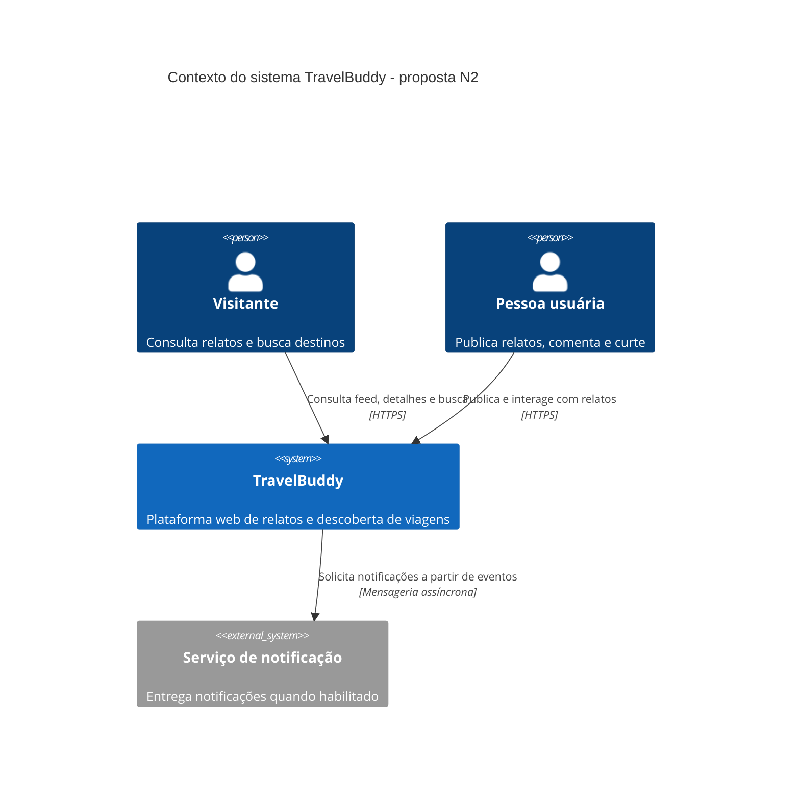
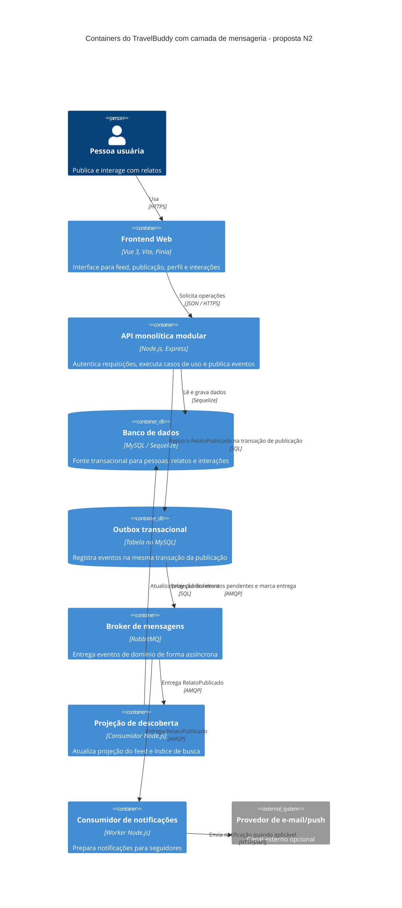

# Questão 2 - Comunicação assíncrona e modelo C4

## Caso de negócio escolhido

Quando um novo relato é publicado, o TravelBuddy precisa atualizar a experiência de descoberta e pode futuramente notificar seguidores. Hoje o frontend chama a API Express e lê o banco MySQL. A proposta adiciona publicação assíncrona do evento `RelatoPublicado`, permitindo que consumidores de feed/busca e notificações trabalhem sem manter a requisição HTTP aberta.

## Diagrama C4 - Contexto

## Diagrama C4 - Containers

Os diagramas C4 Mermaid são fontes textuais editáveis. A arquitetura é uma proposta de evolução; RabbitMQ, outbox e consumidores não estão implementados no repositório da aplicação.

## Justificativa de negócio

- A publicação do relato pode ser confirmada sem aguardar processamento de notificações ou reconstrução da descoberta.
- Busca, feed e notificações evoluem com menor dependência temporal entre si e com o fluxo de publicação.
- Consumidores podem ser escalados conforme o volume de eventos; falhas em uma integração externa não precisam interromper o cadastro do relato.
- Eventos como `RelatoPublicado`, `RelatoAtualizado` e `RelatoRemovido` tornam explícitas mudanças relevantes do domínio e permitem novos consumidores sem acoplar o caso de uso a cada funcionalidade.

## Escolhas técnicas e garantias

- **RabbitMQ com AMQP**: adequado para filas de trabalho, roteamento por tópicos e confirmação de entrega entre API e workers. O broker é uma decisão proposta, não uma dependência atual.
- **Transactional Outbox em MySQL**: a gravação do relato e do evento pendente ocorre na mesma transação. Um relay publica eventos pendentes e só os marca como enviados após confirmação do broker, evitando a janela clássica em que o banco confirma a publicação mas a mensagem se perde antes de ser enviada.
- **Entrega pelo menos uma vez**: consumidores podem receber duplicatas; cada evento tem `eventId` e consumidor idempotente mantém registro de processamento. Não se promete “exactly once”.
- **Contrato de evento versionado**: por exemplo, `eventId`, `eventType`, `version`, `occurredAt`, `relatoId`, `autorId`; payload minimizado para não expor dados pessoais desnecessários.
- **Resiliência operacional**: política de retry com atraso, fila de mensagens mortas (DLQ), métricas de atraso/erros, rastreamento por `correlationId` e alerta para backlog.
- **Consistência eventual**: a projeção de busca/feed pode levar alguns instantes para refletir a nova publicação; a interface pode confirmar “publicado” e atualizar a lista após a projeção ou mostrar estado transitório.
- **Segurança**: broker em rede privada, credenciais em segredo de ambiente, TLS quando atravessar rede não confiável, permissões mínimas por usuário/fila.

## Fluxo proposto

1. API valida a solicitação e inicia uma transação MySQL.
2. Caso de uso grava o relato e uma linha `RelatoPublicado` na outbox, atomicamente.
3. API confirma a publicação ao frontend após commit.
4. Relay lê a outbox e publica no RabbitMQ com confirmação; marca a linha como processada.
5. Consumidores independentes atualizam a descoberta e, se aplicável, preparam notificações. Mensagens falhas após retries vão para DLQ e são observadas para reprocessamento.
